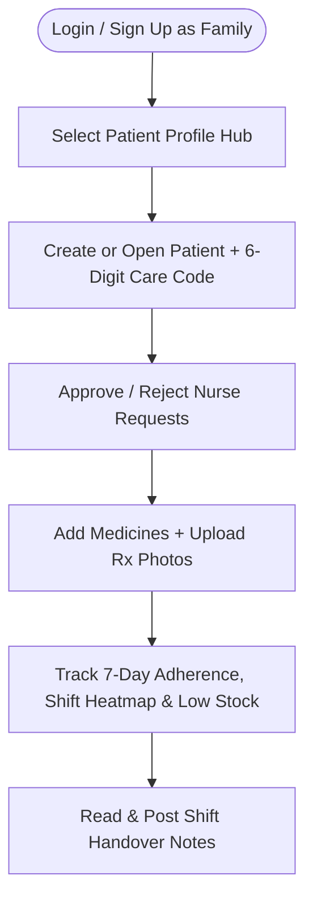
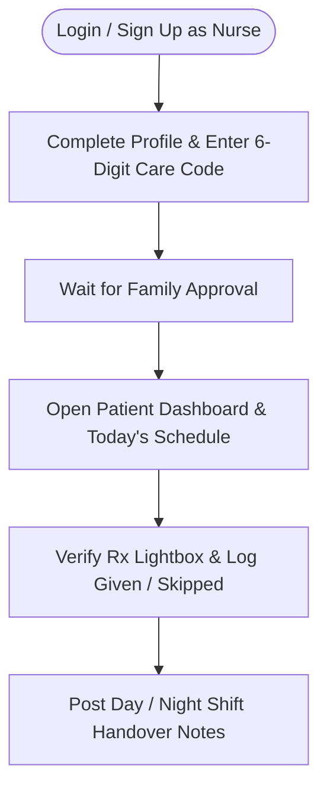
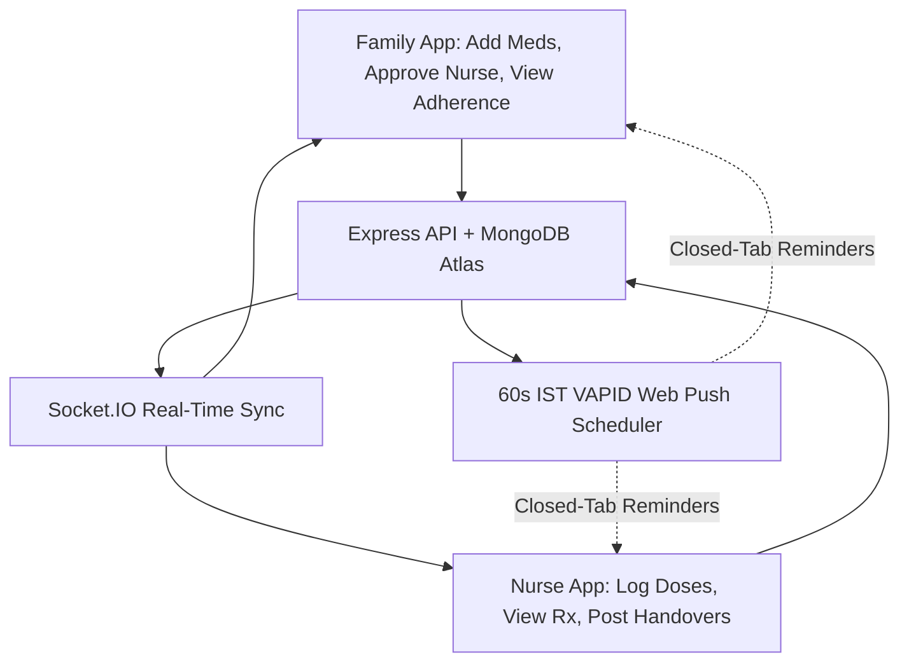

# TheCarePal MedSync — Medication Schedule & Reminders (Task FS-05)

> **Shared Medication Schedule, 7-Day Adherence Analytics & Real-Time Home Care Coordination**  
> Built for **TheCarePal** (*"Trusted Care at Home"*) — Full Stack Developer Intern Assignment (`FS-05`).

---

## Live Production Links

| Resource | URL | Notes |
| :--- | :--- | :--- |
| **Live Web App (Frontend)** | [https://the-care-pal-amr8.vercel.app](https://the-care-pal-amr8.vercel.app) | Deployed on Vercel (auto-deploys from `main`) |
| **Backend API & Socket.IO** | [https://thecarepal.onrender.com](https://thecarepal.onrender.com) | Deployed on Render Web Service (`server/server.js`) |
| **API Health Check** | [https://thecarepal.onrender.com/api/health](https://thecarepal.onrender.com/api/health) | Returns API status and MongoDB Atlas connection state |

> **Note on Render Free Tier:** The backend spins down after 15 minutes of inactivity. The first request after sleep may take 30–50 seconds to wake up; subsequent requests respond in milliseconds.

---

## System Flowcharts

### 1. Family Flow



### 2. Nurse / Caretaker Flow



### 3. Combined System Flow



---

## What Was Built (Mapped to FS-05 Requirements)

### Core Features (Must-Have)
- **Medicine Management (FS-05 JSON Schema):** Family members add medications with `name`, `strength`, `dose`, `times` (`["08:00", "20:00"]`), `food` (`before | after | any`), `startDate`, `endDate`, and stock thresholds—matching the exact JSON contract for downstream prescription-reading AI integration.
- **Daily Caregiver Shift Board:** Nurses/caretakers see today's doses organized into **Morning (05:00–11:59)**, **Afternoon (12:00–16:59)**, and **Night (17:00–23:59)** with 48px touch targets to log doses as **Given** or **Skipped** (requiring a clinical skip reason such as *Patient Asleep*, *Refused Medicine*, or *Fasting for Lab Test*).
- **7-Day Family Adherence & Shift Consistency:** Displays the weekly adherence percentage, a 7-day circular streak tracker, a **3×7 Shift Consistency Heatmap** (Morning / Afternoon / Night across the past 7 days), and a **Skipped Doses Feed** with caregiver attribution and timestamps.
- **Dose-Time Reminders & Overdue Alerts (VAPID Web Push + Web Audio):**
  - **Closed-Tab Push Notifications:** Uses the free `web-push` (VAPID) standard + a registered Service Worker (`client/public/sw.js`) and a 60-second IST backend scheduler (`server/utils/pushScheduler.js`) to send dose-time reminders even when the browser tab is closed. Subscriptions are cleaned up automatically on logout.
  - **In-App Overdue Watcher:** Automatically monitors pending doses every 30 seconds and triggers a 3-tone Web Audio chime + dismissible **Overdue Dose** banner once a dose passes its 15-minute grace window.
- **Automatic Stock Tracking & Refill Warnings:** Marking a dose **Given** atomically decrements `currentStock` by `1`. Whenever remaining supply falls within `lowStockThresholdDays`, both Family and Caretaker views display low-stock refill warnings.

### Bonus & Product-Sense Features
- **Per-Medicine Prescription Photo Upload & Lightbox *(Good-to-Have)*:** Family members attach prescription photos per medicine via **Cloudinary** (so multi-specialist prescriptions from a cardiologist and diabetologist never overwrite each other). Nurses click **View Prescription** directly on any dose card to verify the original doctor's order in a full-screen lightbox before administering.
- **Shift Handover Notes *(Good-to-Have)*:** Timestamped **Day to Night** and **Night to Day** shift notes synced in real time between caregivers and family members.
- **Approval-Gated 6-Digit Care Code Pairing:** Caretakers enter a patient's 6-digit Care Code to request access. Medical records stay locked in a **Pending Approval** state while Family hears a live Web Audio chime, reviews the nurse's credentials (qualification, age, sex, photo), and clicks **Approve** or **Reject**. Family admins can also revoke caregiver access or rotate the Care Code in one click.
- **Accidental Double-Dose Prevention:** Enforced at both the database layer (MongoDB compound unique index on `patientId + medicineId + scheduledDate + scheduledTime`) and the UI layer (logged cards switch to **Locked (Recorded)**).
- **Select Profile Hub & Complete Patient Profiles:** Supports managing multiple patients with a dedicated profile selection screen, **Family Member** vs. **Patient (Self)** onboarding, and prominent display of allergies, emergency contacts, and location for bedside safety.

---

## What I Would Build Next

1. **AI Prescription-to-Schedule Scanner:** Pass uploaded Cloudinary prescription images to a Vision LLM (Gemini) to automatically extract all medicines directly into the `FS-05` JSON schema (`name`, `strength`, `dose`, `times`, `food`, `startDate`, `endDate`) and pre-fill the Add Medicine form—plus a reusable **Prescription Vault** for multi-drug sheets.
2. **Allergy & Drug-Interaction Safety Checks:** Cross-check newly added medicines against the patient's recorded `allergies` and existing schedule times to flag allergy conflicts or timing clashes (e.g., thyroid medication scheduled alongside calcium).
3. **Alternate-Day & Custom-Day Scheduling:** Extend `Medicine` with optional `frequency` (`daily | alternate | custom`) and `daysOfWeek` fields so weekly vitamins or Mon/Wed/Fri regimens calculate schedules, adherence denominators, and stock burn rates accurately.
4. **Voice-to-Handover Notes (Multilingual):** Let home-care nurses record short voice notes in regional Indian languages (Hindi, Kannada, Telugu, Tamil) and auto-transcribe/translate them into structured English handover notes.
5. **Offline-First PWA & Dedicated Push Worker:** Cache today's schedule in IndexedDB so nurses in low-connectivity homes can log doses offline and auto-sync when reconnected, paired with an always-on cron worker (or Firebase Cloud Functions) to eliminate free-tier server sleep for 24/7 push delivery.
6. **Patient Archive / Delete & Doctor Visit PDF Export:** Add soft-archive/delete controls for families, a **Leave Patient** option for nurses, and a one-click 7-day Doctor Visit Summary PDF.

---

## Technology Stack & Architecture

| Layer | Technology | Role |
| :--- | :--- | :--- |
| **Frontend** | React 18, Vite, Tailwind CSS, Lucide React | Mobile-first SPA with `Plus Jakarta Sans` & `Inter` typography |
| **Real-Time Sync** | Socket.IO (Client & Server) | Room-based live updates (`patient_${id}` and `user_${id}`) without page refreshes |
| **Backend** | Node.js, Express (`server/server.js`) | REST API, JWT auth, IST date utilities, and 60s push scheduler |
| **Database** | MongoDB Atlas (Mongoose) | Document store with unique compound double-dose index |
| **Notifications** | `web-push` (VAPID), Service Worker (`sw.js`), Web Audio API | Closed-tab system push notifications + in-app chimes |
| **Media Storage** | Cloudinary (unsigned upload preset) | Per-medicine prescription photos & optional profile pictures |

### FS-05 Medicine JSON Shape (`server/models/Medicine.js`)
```json
{
  "name": "Amlodipine",
  "strength": "5mg",
  "dose": "1 tablet",
  "times": ["08:00"],
  "food": "after",
  "startDate": "2026-11-12",
  "endDate": "2026-12-19"
}
```

---

## Local Setup & Run Instructions

### Prerequisites
- Node.js v18+ and npm v9+
- MongoDB Atlas connection string
- Optional: Free Cloudinary account (unsigned upload preset for photos)

### 1. Clone the Repository
```bash
git clone https://github.com/nehalikareddy/thecarepal.git
cd thecarepal
```

### 2. Configure & Start Backend (`server/`)
```bash
cd server
npm install
```

Generate free VAPID keys for Web Push notifications:
```bash
npx web-push generate-vapid-keys
```

Create `server/.env` (see `server/.env.example` — never commit `.env`):
```env
PORT=5000
MONGODB_URI=your_mongodb_atlas_connection_string
JWT_SECRET=your_super_secret_jwt_key
CLIENT_URL=http://localhost:5173
VAPID_PUBLIC_KEY=your_generated_public_key
VAPID_PRIVATE_KEY=your_generated_private_key
VAPID_SUBJECT=https://the-care-pal-amr8.vercel.app
```

Start the server:
```bash
npm run dev   # or: node server.js
```

### 3. Configure & Start Frontend (`client/`)
```bash
cd ../client
npm install
```

Create `client/.env` (see `client/.env.example` — note `VITE_API_URL` has **no** `/api` suffix):
```env
VITE_API_URL=http://localhost:5000
VITE_CLOUDINARY_CLOUD_NAME=your_cloudinary_cloud_name
VITE_CLOUDINARY_UPLOAD_PRESET=carepal_prescriptions
```

Start the Vite dev server:
```bash
npm run dev
```

---

## Key REST API Endpoints

| Group | Endpoints |
| :--- | :--- |
| **Auth & Profiles** | `POST /api/auth/register`, `POST /api/auth/login`, `GET /api/auth/me`, `PUT /api/auth/profile` |
| **Patients & Care Team** | `GET /api/patients`, `POST /api/patients`, `PUT /api/patients/:id`, `POST /api/patients/join`, `GET /api/patients/my-pending`, `GET /api/patients/:id/members`, `POST /api/patients/:id/requests/:userId/approve`, `POST /api/patients/:id/requests/:userId/reject`, `DELETE /api/patients/:id/members/:userId`, `POST /api/patients/:id/rotate-code` |
| **Medicines & Schedule** | `GET /api/medicines/patient/:patientId`, `POST /api/medicines`, `PUT /api/medicines/:id`, `DELETE /api/medicines/:id`, `GET /api/schedule/today/:patientId` |
| **Doses & Adherence** | `POST /api/doses/log`, `GET /api/adherence/weekly/:patientId` |
| **Handovers & Push** | `GET /api/handovers/:patientId`, `POST /api/handovers/:patientId`, `GET /api/notifications/vapid-public-key`, `POST /api/notifications/subscribe`, `POST /api/notifications/unsubscribe` |

---

## AI Tools Used & Contribution Breakdown

This project was developed with assistance from **Google Gemini** and **Antigravity IDE** while I reviewed, tested, and verified every flow end-to-end:

- **Architecture & Planning (Gemini):** Designed the dual-role workflow, approval-gated Care Code state machine, per-medicine prescription strategy, MongoDB double-dose unique index, and VAPID Web Push architecture.
- **Code Implementation & Debugging (Antigravity IDE + Gemini):** Scaffolded React/Tailwind components and Express routes, diagnosed and fixed a React Rules of Hooks crash (`Error #310`), resolved JWT secret/authorization mismatches on seeded patients, and replaced full-component remounts with silent background Socket.IO refreshes.
- **UI/UX Iteration (Gemini):** Explored mobile-first adherence layouts before implementing the 7-day streak circle + 3×7 shift consistency heatmap and refined typography (`Plus Jakarta Sans` + `Inter`).